<div align="center">

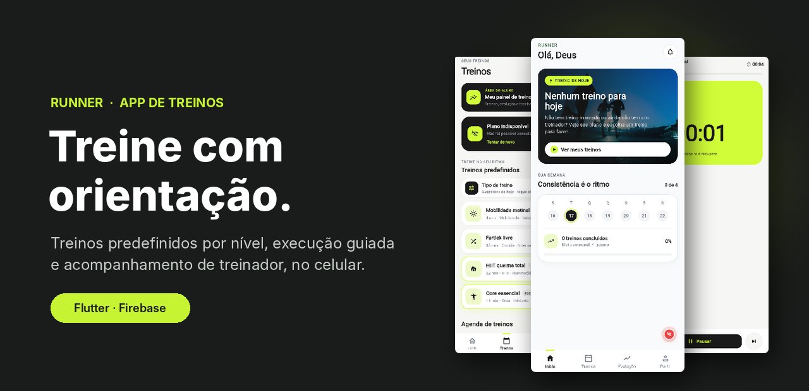

<br>
<br>


</div>

# Runner — Aplicativo de Treinos

O **Runner** é um aplicativo mobile que ajuda as pessoas a treinar com orientação, mesmo quem treina por conta própria. Ele reúne treinos predefinidos por nível, execução guiada, evolução e acompanhamento de um personal trainer em um único lugar.

## Proposta

Muitas pessoas se machucam ao treinar sozinhas: aumentam a carga rápido demais, fazem treinos que não são do seu nível ou executam os exercícios do jeito errado. O Runner resolve isso com **treinos prontos para cada nível**, **treino guiado exercício a exercício** e **um personal trainer acompanhando** a evolução do aluno.

## Telas

### Acesso

<table>
  <tr>
    <td align="center">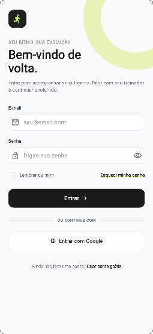</td>
    <td align="center">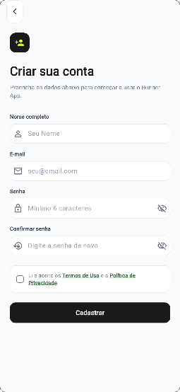</td>
    <td align="center"></td>
  </tr>
  <tr>
    <td align="center"><b>Login</b><br><sub>E-mail e senha ou Google</sub></td>
    <td align="center"><b>Criar conta</b><br><sub>Cadastro com aceite dos termos</sub></td>
    <td align="center"><b>Recuperar senha</b><br><sub>Link de redefinição por e-mail</sub></td>
  </tr>
</table>

### Treinos

<table>
  <tr>
    <td align="center">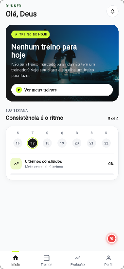</td>
    <td align="center">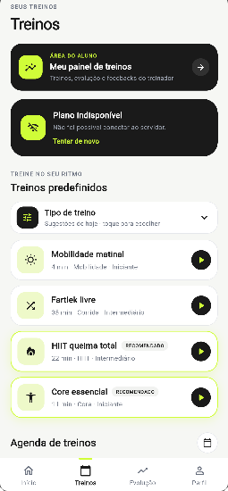</td>
    <td align="center">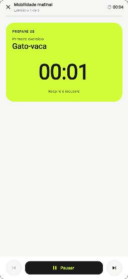</td>
    <td align="center">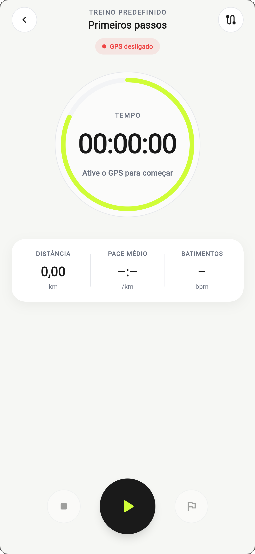</td>
  </tr>
  <tr>
    <td align="center"><b>Início</b><br><sub>Treino de hoje e constância da semana</sub></td>
    <td align="center"><b>Treinos</b><br><sub>Treinos predefinidos por tipo e nível</sub></td>
    <td align="center"><b>Treino guiado</b><br><sub>Exercício a exercício, com cronômetro</sub></td>
    <td align="center"><b>Treino ao ar livre</b><br><sub>Tempo, distância e pace com GPS</sub></td>
  </tr>
</table>

### Personal trainer

<table>
  <tr>
    <td align="center">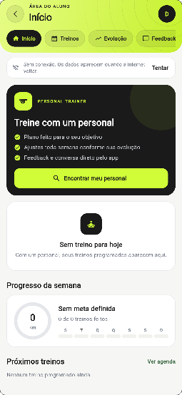</td>
    <td align="center">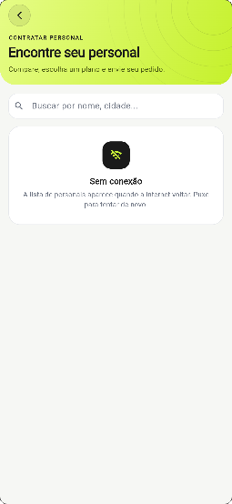</td>
  </tr>
  <tr>
    <td align="center"><b>Área do aluno</b><br><sub>Plano, progresso da semana e próximos treinos</sub></td>
    <td align="center"><b>Encontre seu personal</b><br><sub>Busca por nome ou cidade e pedido de contratação</sub></td>
  </tr>
</table>

### Acompanhamento

<table>
  <tr>
    <td align="center">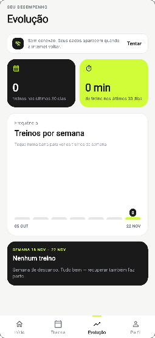</td>
    <td align="center">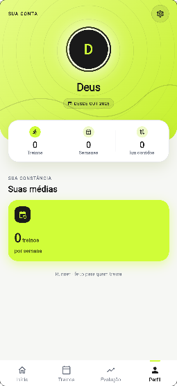</td>
    <td align="center">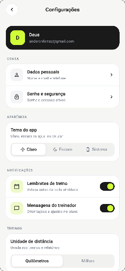</td>
  </tr>
  <tr>
    <td align="center"><b>Evolução</b><br><sub>Treinos por semana e tempo treinado</sub></td>
    <td align="center"><b>Perfil</b><br><sub>Totais e média de treinos</sub></td>
    <td align="center"><b>Configurações</b><br><sub>Conta, tema, notificações e unidades</sub></td>
  </tr>
</table>

## Funcionalidades

- **Treinos Predefinidos** — mobilidade, corrida, HIIT, core e mais, separados por tipo e nível (iniciante e intermediário), com duração.
- **Treino Guiado** — mostra o exercício atual e o próximo, com cronômetro e opções de pausar, voltar e avançar.
- **Treinos ao Ar Livre** — tempo, distância e pace com GPS.
- **Progresso da Semana** — treinos concluídos, meta semanal e constância.
- **Evolução** — treinos por semana, tempo treinado e histórico de desempenho.
- **Personal Trainer** — encontre e contrate um personal; na área do aluno ficam o plano feito para o seu objetivo, os ajustes semanais e o feedback do personal, com conversa direto pelo app.
- **Segurança** — botão de emergência durante o treino.
- **Modo Offline** — avisa quando está sem conexão e mostra os dados quando a internet volta.
- **Perfil e Configurações** — dados da conta, tema claro, escuro ou do sistema, notificações e unidade de distância.
- **Login** — acesso por e-mail, senha ou Google, com recuperação de senha.

## Interface

O aplicativo utiliza uma interface **minimalista, moderna e intuitiva**, com predominância de preto e branco e destaques em verde-limão, além de suporte a tema escuro.

## Navegação

A navegação principal é composta por:

- **Início** — treino de hoje e progresso da semana
- **Treinos** — treinos predefinidos e agenda de treinos
- **Evolução** — desempenho e constância
- **Perfil** — conta, médias e configurações

## Tecnologias

**Aplicativo:** Flutter, Dart, Firebase Auth, Google Sign-In, geolocator e connectivity_plus.

**API:** Node.js, Express, Prisma, MySQL 8, JWT, bcrypt, Zod e Swagger/OpenAPI.

## Como rodar

```bash
git clone [https://github.com/BancoCentraI/runner.git](https://github.com/BancoCentraI/runner.git)
cd runner/runner-app
flutter pub get
echo "API_BASE_URL=[https://sua-api.com.br/api](https://sua-api.com.br/api)" > .env
flutter run
